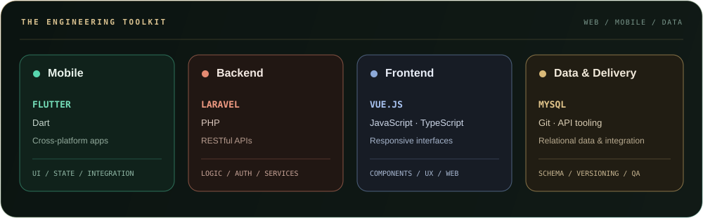

  
  &nbsp;&nbsp;
  

    
  

  

    <a href="mailto:ali.q.alomary@gmail.com">البريد الإلكتروني</a> ·
    <a href="https://linkedin.com/in/ali-al-omary">LinkedIn</a> ·
    <a href="https://alomary-ali.site.je">معرض الأعمال</a> ·
    <a href="https://github.com/Alomary-Ali">GitHub</a>
  

---

## نبذة عني

أنا **مطور Laravel مبتدئ ومطور ويب Full-Stack** من صنعاء، اليمن. أركز على بناء حلول ويب وتطبيقات عملية، مع الاهتمام بتنظيم الأنظمة الخلفية، وقابلية صيانة الكود، وتقديم تجربة استخدام موثوقة.

- **Backend:** PHP، Laravel، REST APIs، المصادقة وإدارة الصلاحيات
- **تطبيقات الهاتف:** Flutter وDart
- **Frontend:** Vue.js، TypeScript، JavaScript
- **قواعد البيانات:** MySQL وتصميم قواعد البيانات العلائقية
- **ممارسات التطوير:** تنظيم المشاريع حسب الميزات، Clean Code، الاختبارات، وقابلية الصيانة

## مشاريع مختارة

### [NAHJ | نهج](https://github.com/Alomary-Ali/nahj)
تصور لمنصة معرفة واكتشاف تجمع بين أكاديمية تعليمية تُدار مركزياً ومساحة لاكتشاف المصادر التعليمية والفرص الخارجية. تعرض المنصة المصادر الأصلية وتحيل المستخدم إليها بدلاً من إعادة نشر محتواها.

### [Awesome Generative AI Guide](https://github.com/Alomary-Ali/awesome-generative-ai-guide)
دليل منظم لمصادر وأدوات ومواد تعلم الذكاء الاصطناعي التوليدي.

### BNAYTIC
تطبيق Flutter متكامل مع واجهة خلفية مبنية باستخدام Laravel. مستودعات المصدر محدودة الوصول، لذلك لا أعرض تفاصيلها البرمجية هنا.

## التقنيات ومجالات العمل

  

## نشاط GitHub

  
  
    
  

*تعرض هذه الإحصائيات خدمات خارجية، وقد تختلف عن بيانات النشاط المعروضة مباشرة في GitHub.*

## التعليم

**بكالوريوس تقنية المعلومات**  
جامعة الرشيد الذكية · 2022–2026

## التواصل

- البريد الإلكتروني: [ali.q.alomary@gmail.com](mailto:ali.q.alomary@gmail.com)
- LinkedIn: [linkedin.com/in/ali-al-omary](https://linkedin.com/in/ali-al-omary)
- معرض الأعمال: [alomary-ali.site.je](https://alomary-ali.site.je)
- الموقع: صنعاء، اليمن · متاح للتعاون عن بُعد

---

  نبني برمجيات مفيدة، خطوة تطوير مدروسة في كل مرة.

