  <a href="README.md">🇬🇧 English</a> &nbsp;·&nbsp; <a href="README.ar.md">🇾🇪 العربية</a>

    

  

  

    <a href="mailto:ali.q.alomary@gmail.com">✉ Email</a> &nbsp;·&nbsp;
    <a href="https://linkedin.com/in/ali-al-omary-29a474414">LinkedIn</a> &nbsp;·&nbsp;
    <a href="https://alomary-ali.site.je">Portfolio</a> &nbsp;·&nbsp;
    <a href="https://github.com/Alomary-Ali">GitHub</a>
  

  
SA'NA'A, YEMEN &nbsp; / &nbsp; BUILDING FOR THE WEB AND MOBILE

---

## The Developer

I'm a **Full-Stack Developer** working across **Flutter, Laravel, frontend, and backend development**. I enjoy turning product ideas into practical digital experiences, from mobile interfaces and web frontends to APIs, application logic, and relational data.

My focus is on building software that is understandable, maintainable, and useful beyond the first release.

## Engineering Focus

  

| Area | Technologies |
|:--|:--|
| **Mobile** | Flutter · Dart |
| **Backend** | Laravel · PHP · REST APIs |
| **Frontend** | Vue.js · JavaScript · TypeScript |
| **Database** | MySQL · Relational data modeling |
| **Workflow** | Git · API integration · Testing · Maintainable code |

## Selected Work

<table>
  <tr>
    <td width="50%" valign="top">
      <h3><a href="https://github.com/Alomary-Ali/nahj">NAHJ · نهج</a></h3>
      
A knowledge and discovery platform connecting a centrally managed learning academy with external resources and opportunities. Discovery links people to original sources.

      PRODUCT CONCEPT · KNOWLEDGE · DISCOVERY
    </td>
    <td width="50%" valign="top">
      <h3><a href="https://github.com/Alomary-Ali/awesome-generative-ai-guide">Awesome Generative AI Guide</a></h3>
      
A curated collection of generative AI resources, tools, and learning material, organized to make exploration easier.

      OPEN SOURCE · GENERATIVE AI · CURATION
    </td>
  </tr>
  <tr>
    <td colspan="2" valign="top">
      <h3>BNAYTIC</h3>
      
A Flutter mobile application integrated with a Laravel backend. Its source repositories are access-restricted, so private implementation details are intentionally kept private.

      FLUTTER · LARAVEL · MOBILE + API
    </td>
  </tr>
</table>

## GitHub Activity

  
  
    
  

Activity cards are generated by third-party services and may occasionally be unavailable or differ from GitHub's native activity view.

## Background

**Bachelor of Information Technology**  
Al-Rasheed Smart University · 2022–2026

## Let's Connect

- **Email:** [ali.q.alomary@gmail.com](mailto:ali.q.alomary@gmail.com)
- **LinkedIn:** [linkedin.com/in/ali-al-omary-29a474414](https://linkedin.com/in/ali-al-omary-29a474414)
- **Portfolio:** [alomary-ali.site.je](https://alomary-ali.site.je)
- **Location:** Sana'a, Yemen · Open to remote collaboration

---

  DESIGN WITH CLARITY. ENGINEER WITH INTENT. SHIP WITH CARE.

