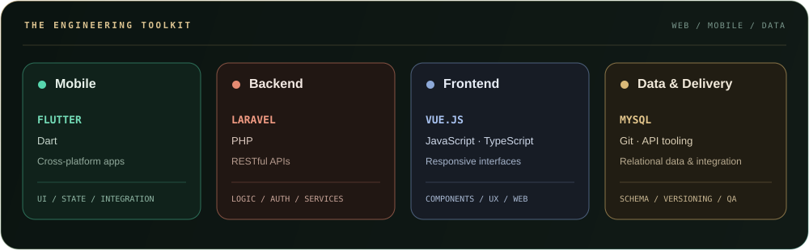

  
  &nbsp;&nbsp;
  

    
  

  

    <a href="mailto:ali.q.alomary@gmail.com">Email</a> ·
    <a href="https://linkedin.com/in/ali-al-omary">LinkedIn</a> ·
    <a href="https://alomary-ali.site.je">Portfolio</a> ·
    <a href="https://github.com/Alomary-Ali">GitHub</a>
  

---

## About

I'm a **Junior Laravel Developer | Full-Stack Web Developer** based in Sana'a, Yemen. I focus on building practical web and mobile solutions, with an emphasis on maintainable backend systems, clear application structure, and reliable user experiences.

- **Backend:** PHP, Laravel, REST APIs, authentication and authorization
- **Mobile:** Flutter and Dart
- **Frontend:** Vue.js, TypeScript, JavaScript
- **Data:** MySQL and relational database design
- **Practices:** Feature-oriented organization, clean code, testing, and maintainability

## Selected Projects

### [NAHJ | نهج](https://github.com/Alomary-Ali/nahj)
A knowledge and discovery platform concept combining a centrally managed learning academy with discovery of external learning resources and opportunities. Discovery entries link to their original sources rather than republishing them.

### [Awesome Generative AI Guide](https://github.com/Alomary-Ali/awesome-generative-ai-guide)
A curated guide to generative AI resources, tools, and learning materials.

### BNAYTIC
A Flutter application integrated with a Laravel backend. The source repositories are access-restricted, so implementation details are intentionally not published here.

## Technology

  

## GitHub Activity

  
  
    
  

*Statistics are provided by third-party services and may differ from GitHub's own activity views.*

## Education

**Bachelor of Information Technology**  
Al-Rasheed Smart University · 2022–2026

## Contact

- Email: [ali.q.alomary@gmail.com](mailto:ali.q.alomary@gmail.com)
- LinkedIn: [linkedin.com/in/ali-al-omary](https://linkedin.com/in/ali-al-omary)
- Portfolio: [alomary-ali.site.je](https://alomary-ali.site.je)
- Location: Sana'a, Yemen · Open to remote collaboration

---

  Building useful software, one thoughtful iteration at a time.

